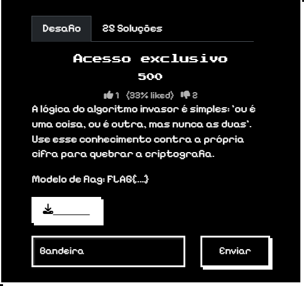
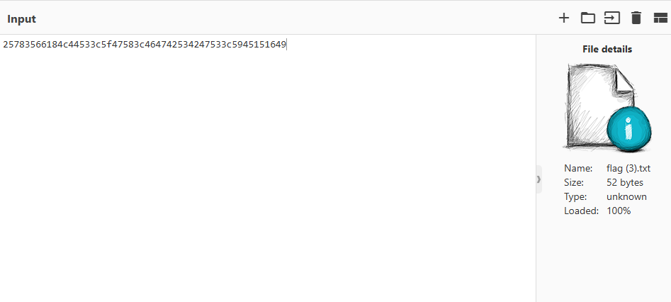
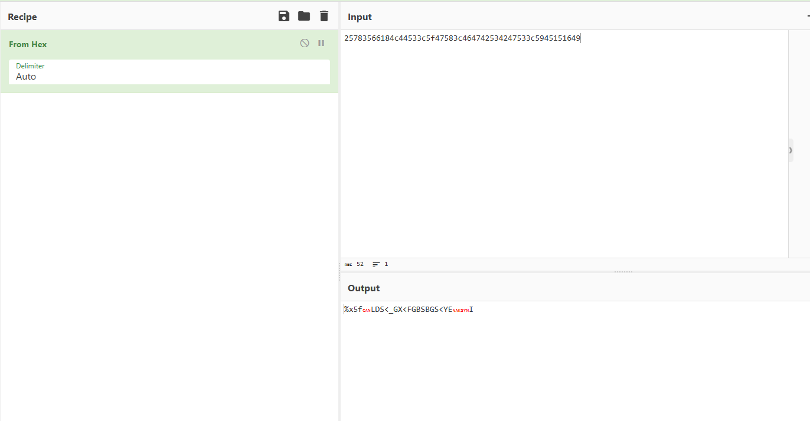
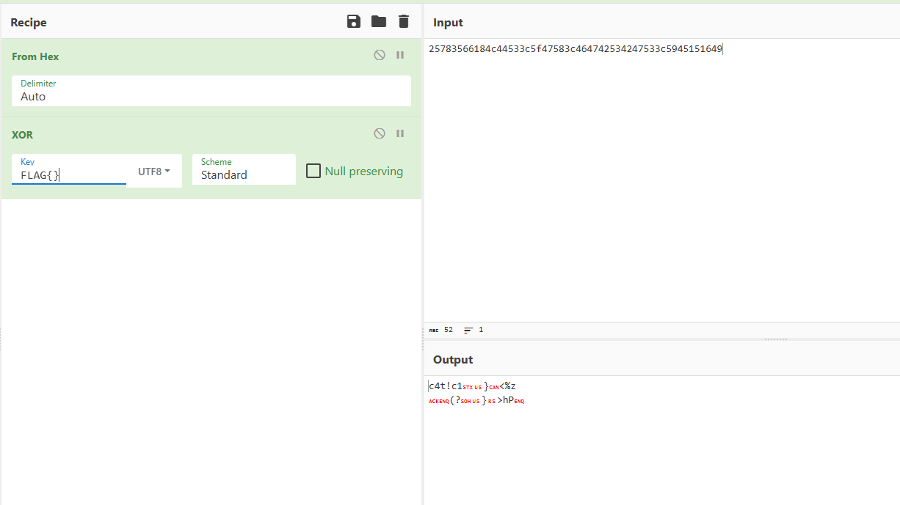
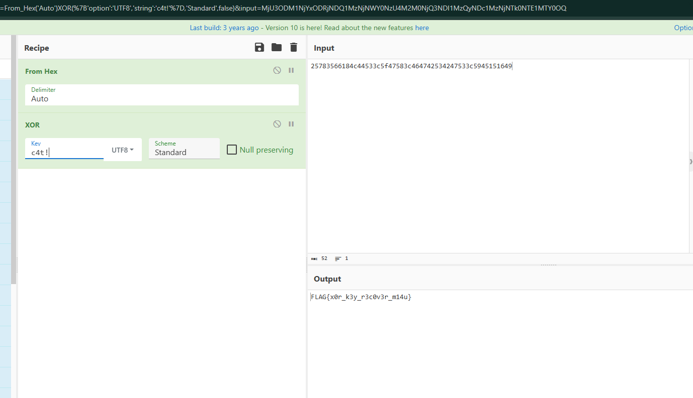

# Relatório – Desafio “Acesso exclusivo”

**Disciplina:** Escola de Cyber
**Aluno:** Murilo Soares Guislande
**Data:** 14/08/2026

---

## 1. Objetivo

O objetivo desta atividade foi analisar um arquivo criptografado e identificar o método utilizado para ocultar a *flag* do desafio. A resolução exigiu interpretação da pista fornecida pelo enunciado, testes de hipóteses e uso da ferramenta **CyberChef** para aplicar operações de decodificação até obter o texto original.

---

## 2. Ambiente Utilizado

* **Sistema Operacional:** Windows 11
* **Navegador:** Google Chrome
* **Ferramenta de Análise:** CyberChef (v10)
* **Plataforma do Desafio:** Escola de Cyber

---

## 3. Descrição do Desafio

O desafio intitulado **“Acesso exclusivo”** apresentava a seguinte pista:

> *“A lógica do algoritmo invasor é simples: ‘ou é uma coisa, ou é outra, mas nunca as duas’. Use esse conhecimento contra a própria cifra para quebrar a criptografia.”*

O modelo de resposta exigido era `FLAG{...}`.

Ao abrir o arquivo fornecido, foi observada a seguinte sequência hexadecimal:

```text
25783566184c44533c5f47583c464742534247533c5945151649
```

### Tela do desafio



---

## 4. Análise Inicial

A expressão **“ou exclusivo”** chamou atenção imediatamente, pois em lógica digital ela se refere ao operador **XOR (Exclusive OR)**. Em criptografia, cifras XOR são muito comuns em desafios introdutórios de CTF, especialmente quando há uma chave curta repetida ao longo da mensagem.

A hipótese inicial foi:

* Os dados estavam em **hexadecimal**;
* Após converter o hexadecimal para bytes, o conteúdo teria sido cifrado com **XOR** usando uma chave textual.

Essa interpretação foi reforçada pela própria frase *“nunca as duas”*, definição clássica do operador XOR.

---

## 5. Explicação Técnica do Processo

### 5.1 Conversão de Hexadecimal (`From Hex`)

A primeira etapa consistiu em converter a string hexadecimal para bytes utilizando a operação **From Hex** no CyberChef.

Resultado intermediário:

```text
%x5f... (dados binários/textuais)
```

O conteúdo resultante não era legível, indicando que ainda havia uma camada de cifra.

### 5.2 Teste da Hipótese XOR

Sabendo que o formato final deveria ser `FLAG{...}`, foi utilizada a propriedade do XOR:

* Se `C = P XOR K`, então `P = C XOR K`.

Assumindo que o texto plano começaria com `FLAG{`, foi possível deduzir os primeiros bytes da chave. O cálculo revelou a sequência:

```text
c4t!
```

Essa chave fazia sentido semântico e produziu texto legível.

### 5.3 Aplicação do XOR

Aplicando a operação **XOR** no CyberChef com a chave `c4t!`, obteve-se diretamente a *flag*.

---

## 6. Procedimento Realizado

1. O conteúdo hexadecimal foi copiado do arquivo fornecido.
2. O CyberChef foi aberto no navegador.
3. Os dados foram colados no painel **Input**.
4. Foi criada a seguinte receita:

   * `From Hex`
   * `XOR` (chave: `c4t!`)
5. O resultado foi exibido automaticamente no painel **Output**.

---

## 7. Evidências da Execução

### Entrada hexadecimal



### Conversão inicial de hexadecimal



### Teste inicial incorreto de chave



### Aplicação da chave correta



---

## 8. Análise dos Resultados

O fluxo de decodificação pode ser resumido na tabela abaixo:

| Etapa | Entrada            | Operação     | Saída                  |
| ----- | ------------------ | ------------ | ---------------------- |
| 1     | String hexadecimal | `From Hex`   | Bytes cifrados         |
| 2     | Bytes cifrados     | `XOR (c4t!)` | Texto legível / *Flag* |

A dedução da chave a partir do prefixo conhecido `FLAG{` foi o ponto decisivo da resolução.

---

## 9. Resultado Obtido

A *flag* validada na plataforma foi:

```text
FLAG{x0r_k3y_r3c0v3r_m14u}
```

O sufixo **“m14u”** faz referência ao som de um gato, reforçando a dica implícita na chave `c4t!`.

---

## 10. Conclusão

A atividade demonstrou na prática o funcionamento de uma cifra XOR simples e a importância da análise semântica do enunciado. A pista textual foi suficiente para levantar a hipótese correta, mostrando que em muitos desafios de segurança a interpretação do contexto é tão importante quanto a ferramenta utilizada.

Além disso, o exercício reforçou conceitos fundamentais de:

* representação hexadecimal;
* operação lógica XOR;
* recuperação de chave por texto conhecido (*known-plaintext attack*);
* análise de padrões em desafios de CTF.

O uso do **CyberChef** permitiu testar rapidamente diferentes hipóteses até chegar à solução correta.

---

## 11. Referências

* CyberChef: https://gchq.github.io/CyberChef/
* XOR Cipher – Wikipedia: https://en.wikipedia.org/wiki/XOR_cipher
* Documentação da Escola de Cyber
