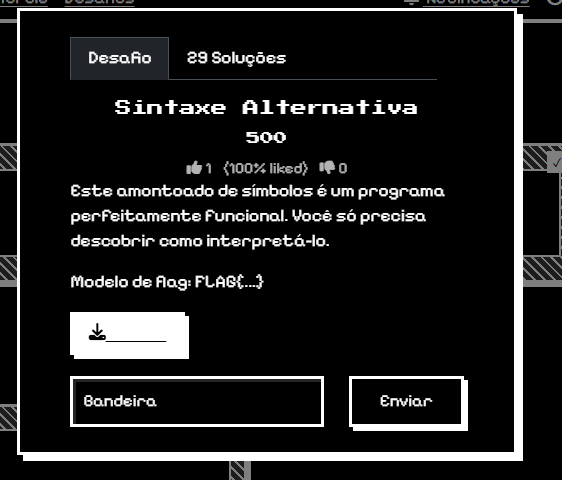

# Relatório – Desafio “Cebola Criptográfica”

**Disciplina:** Escola de Cyber  
**Aluno:** Murilo Soares Guislande  
**Data:** 11/08/2026

---

## 1. Objetivo

O objetivo desta atividade foi analisar e decodificar um arquivo de texto contendo dados codificados em múltiplas camadas sucessivas — conceito conhecido em segurança da informação como *Onion Encoding* ("Cebola Criptográfica"). Utilizando a ferramenta **CyberChef**, foram aplicadas operações em sequência até desempacotar todas as camadas de codificação e obter a *flag* correta do desafio.

---

## 2. Ambiente Utilizado

- **Sistema Operacional:** Windows 11
- **Navegador:** Google Chrome
- **Ferramenta de Decodificação:** CyberChef (v10)
- **Plataforma do Desafio:** Escola de Cyber

---

## 3. Descrição do Desafio

O desafio intitulado **"Cebola Criptográfica"** (pontuação: 500) apresentava a seguinte descrição:

> *"À primeira vista, parece apenas linguagem de máquina bruta, mas nossos analistas acreditam que o remetente empacotou a mensagem em várias camadas para burlar nossos filtros."*

O modelo de resposta exigido era `FLAG{...}`. Ao abrir o arquivo fornecido, observou-se uma extensa sequência de blocos de números binários de 8 bits separados por espaço.

### Tela do desafio



---

## 4. Explicação Técnica do Caminho de Decodificação

A técnica de empacotamento em camadas exige que o processo de decodificação seja realizado em ordem exatamente inversa àquela em que os dados foram codificados. O caminho percorrido para chegar ao resultado foi:

### 1ª Camada – Conversão de Binário (`From Binary`)

**Motivo:** Os dados brutos estavam organizados em bytes binários (8 bits compostos por `0`s e `1`s). Ao converter esse conjunto de bytes em ASCII, o resultado revelou uma sequência de valores em formato hexadecimal.

### 2ª Camada – Conversão de Hexadecimal (`From Hex`)

**Motivo:** O resultado da primeira etapa era composto por pares de caracteres hexadecimais (`0-9` e `a-f`). A conversão de hexadecimal para texto revelou uma string em Base64.

### 3ª Camada – Conversão de Base64 (`From Base64`)

**Motivo:** A última camada utilizava codificação Base64. A decodificação final expôs diretamente o texto legível contendo a *flag*.

---

## 5. Procedimento Realizado

1. O conteúdo do arquivo binário fornecido pela plataforma foi copiado integralmente.
2. O CyberChef foi aberto no navegador.
3. Os dados foram colados no painel **Input**.
4. Foi criada a seguinte receita:
   - `From Binary`
   - `From Hex`
   - `From Base64`
5. O CyberChef processou automaticamente as operações encadeadas e revelou a *flag* no painel **Output**.

---

## 6. Evidências da Execução

### Entrada de dados no CyberChef


### Receita aplicada e resultado final


---

## 7. Análise dos Resultados

A sequência de transformações aplicadas pode ser resumida na tabela abaixo:

| Camada | Formato de Entrada | Operação no CyberChef | Saída Resultante |
|--------|--------------------|-----------------------|------------------|
| 1ª Camada | Código Binário (8 bits) | `From Binary` | Texto em Hexadecimal |
| 2ª Camada | Representação Hexadecimal | `From Hex` | String em Base64 |
| 3ª Camada | String Base64 | `From Base64` | Texto claro / *Flag* |

---

## 8. Resultado Obtido

A *flag* decodificada e validada foi:

```text
FLAG{D1v3r54s_c4m4D45}
```

O formato em *leet speak* (`D1v3r54s_c4m4D45`) representa a expressão **“Diversas camadas”**, confirmando a resolução completa do desafio.

---

## 9. Conclusão

A atividade demonstrou na prática o funcionamento do desempacotamento de dados codificados em múltiplas camadas (*Onion Encoding*). O uso do **CyberChef** permitiu encadear as operações de forma simples e eficiente, possibilitando a obtenção da *flag* correta e reforçando conhecimentos sobre codificações comuns em desafios de segurança e CTFs.

---

## 10. Referências

- CyberChef: https://gchq.github.io/CyberChef/
- Documentação da Escola de Cyber
