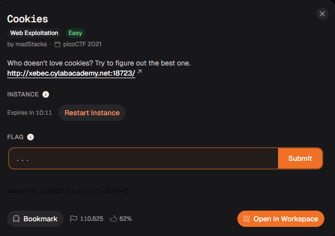
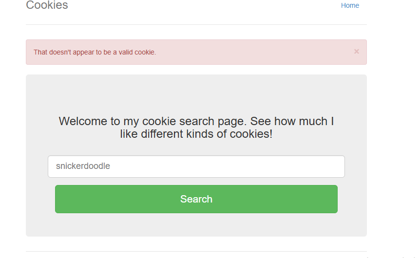
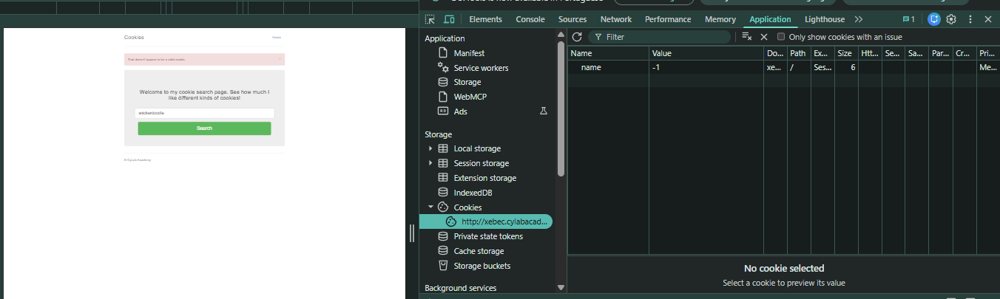
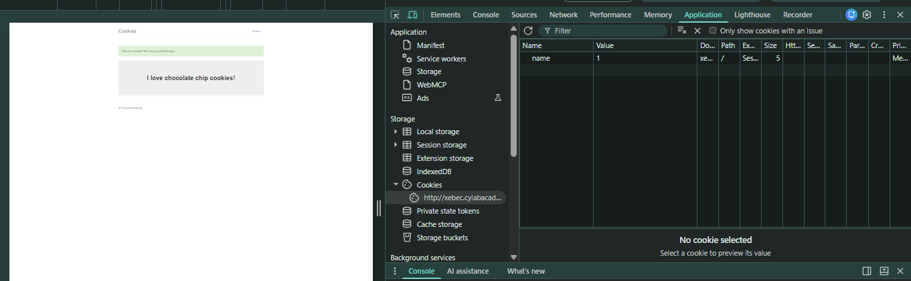
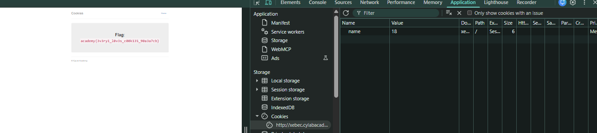

# Relatório – Desafio “Cookies”

**Disciplina:** Escola de Cyber

**Aluno:** Murilo Soares Guislande

**Data:** 11/11/2026

---

## 1. Objetivo

O objetivo desta atividade foi explorar uma aplicação web que controlava o conteúdo exibido com base em um **cookie** armazenado no navegador. A resolução exigiu o uso das **ferramentas do desenvolvedor** do navegador para localizar o cookie, entender seu funcionamento e manipulá-lo até a obtenção da *flag*.

---

## 2. Ambiente Utilizado

* **Navegador:** Google Chrome
* **Ferramenta de Análise:** Ferramentas do desenvolvedor (aba *Application* → *Cookies*)
* **Plataforma do Desafio:** Escola de Cyber (desafio originário do picoCTF 2021)

---

## 3. Descrição do Desafio

O desafio **“Cookies”** (categoria *Web Exploitation*, dificuldade *Easy*) apresentava a seguinte descrição:

> *“Who doesn't love cookies? Try to figure out the best one.”*

Junto ao enunciado era fornecido o endereço de uma instância do site (`http://xebec.cylabacademy.net:18723/`). O modelo de resposta exigido era o formato de flag da plataforma (`academy{...}`).

### Tela do desafio



---

## 4. Análise Inicial

Ao acessar o site, foi exibida uma página de busca de cookies (biscoitos), com um campo de texto, um botão **Search** e a mensagem *“Welcome to my cookie search page. See how much I like different kinds of cookies!”*.

### Tela inicial do site



Ao realizar uma pesquisa, a página retornou o aviso **“That doesn't appear to be a valid cookie.”** (“Isso não parece ser um cookie válido”).

A hipótese inicial foi:

* O nome do desafio (*Cookies*) indicava que a lógica da aplicação dependia de **cookies HTTP** e não apenas do texto digitado;
* A resposta da página poderia estar sendo definida por um valor guardado no navegador, que o usuário consegue editar.

---

## 5. Explicação Técnica do Processo

### 5.1 Inspeção da página

Antes de manipular qualquer dado, a página foi inspecionada com as **ferramentas do desenvolvedor** (tecla `F12`). Os arquivos carregados pela página foram analisados, mas não havia nada relevante neles.

### 5.2 Localização do cookie

Na aba **Application**, em **Storage → Cookies**, foi encontrado um cookie com as seguintes características:

| Campo | Valor |
| ----- | ----- |
| Name | `name` |
| Value | `-1` |
| Path | `/` |
| Expires | Session |

O valor `-1` é compatível com o estado “nenhum cookie válido selecionado”, o que combinava com o aviso de erro exibido pela página.

### Cookie `name` com valor `-1`



### 5.3 Teste de manipulação do cookie

O valor do cookie foi alterado manualmente para `1` e a página foi recarregada. A resposta mudou: a página passou a exibir a mensagem *“I love chocolate chip cookies!”*, indicando que o servidor usava o valor do cookie para decidir qual conteúdo mostrar.

### Cookie `name` com valor `1` e resposta da página



Isso confirmou a hipótese: o conteúdo exibido era controlado por um dado que o próprio usuário pode editar.

### 5.4 Varredura dos valores

Com o comportamento entendido, o valor do cookie foi incrementado de um em um, recarregando a página a cada alteração. A cada novo número, a página passava a indicar outro cookie como o preferido. Ao chegar no valor **18**, a página deixou de mostrar um cookie comum e exibiu a **flag**.

---

## 6. Procedimento Realizado

1. O site do desafio foi acessado pelo endereço fornecido.
2. A página foi inspecionada com as ferramentas do desenvolvedor, sem encontrar nada relevante nos arquivos.
3. Na aba **Application → Cookies**, foi localizado o cookie `name`, com valor `-1`.
4. O valor foi alterado para `1`, e a página passou a exibir um cookie específico.
5. O valor foi incrementado sucessivamente, recarregando a página a cada alteração.
6. No valor `18`, a página exibiu a *flag*.
7. A *flag* foi copiada e enviada na plataforma.

---

## 7. Evidências da Execução

### Flag exibida com o cookie `name` igual a 18



---

## 8. Análise dos Resultados

O comportamento observado pode ser resumido na tabela abaixo:

| Valor do cookie `name` | Resposta da página |
| ---------------------- | ------------------ |
| `-1` | Aviso de cookie inválido |
| `1` | “I love chocolate chip cookies!” |
| `2` a `17` | Outros cookies (biscoitos) indicados como preferidos |
| `18` | *Flag* |

A vulnerabilidade está no fato de o servidor **confiar em um valor controlado pelo cliente** para decidir o que exibir. Como o cookie pode ser editado livremente no navegador, qualquer usuário consegue percorrer todos os valores possíveis. Na aba de cookies, também é possível observar que os campos de proteção como *HttpOnly* e *Secure* não estavam marcados.

Uma forma alternativa de automatizar a varredura seria usar o `curl` em um laço no terminal:

```bash
for i in $(seq 0 25); do
  echo "== name=$i =="
  curl -s --cookie "name=$i" http://xebec.cylabacademy.net:18723/check | grep -i "flag\|cookie"
done
```

> O caminho (`/check`) deve ser ajustado conforme a página que o site exibe após a pesquisa.

---

## 9. Resultado Obtido

A *flag* obtida e validada foi:

```text
academy{3v3ry1_l0v3s_c00k135_90a3a7cb}
```

O texto em *leet speak* (`3v3ry1_l0v3s_c00k135`) lê-se como **“everyone loves cookies”** (“todo mundo ama cookies”), em referência à pergunta do enunciado.

---

## 10. Conclusão

A atividade demonstrou na prática uma falha comum em aplicações web: **confiar em dados enviados pelo cliente**. Como o cookie fica armazenado no navegador do usuário, ele pode ser lido e alterado livremente, e por isso nunca deve ser usado como única fonte de decisão sobre o que o servidor mostra ou permite.

O exercício reforçou conceitos fundamentais de:

* funcionamento de cookies HTTP e onde encontrá-los nas ferramentas do desenvolvedor;
* manipulação de cookies como técnica de teste em aplicações web;
* importância de validar tudo no servidor, e não no cliente;
* boas práticas de segurança, como usar identificadores de sessão aleatórios com o estado guardado no servidor, cookies assinados e as proteções *HttpOnly* e *Secure*.

---

## 11. Referências

* HTTP cookies – MDN Web Docs: https://developer.mozilla.org/pt-BR/docs/Web/HTTP/Cookies
* OWASP – Session Management: https://owasp.org/www-project-web-security-testing-guide/
* Chrome DevTools – Inspecionar cookies: https://developer.chrome.com/docs/devtools/application/cookies
* Documentação da Escola de Cyber
