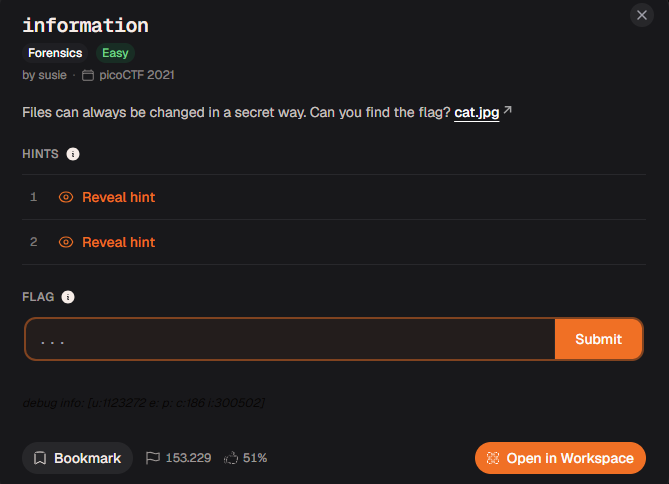
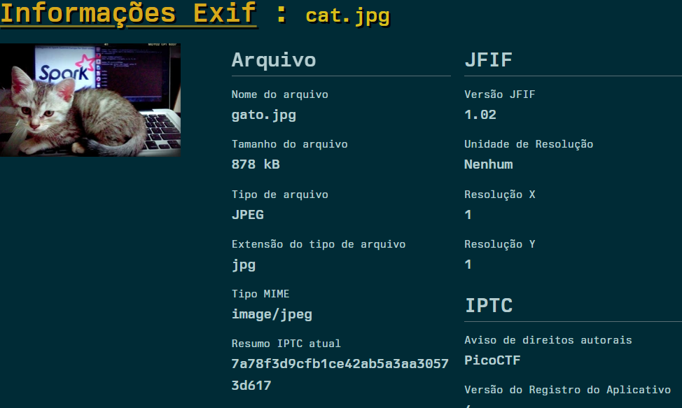
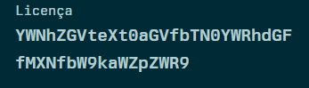
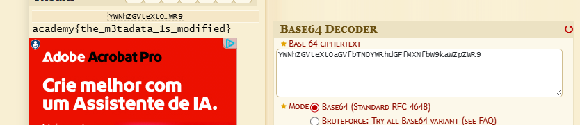

# Relatório – Desafio “information”

**Disciplina:** Escola de Cyber

**Aluno:** Murilo Soares Guislande

**Data:** 11/11/2026

---

## 1. Objetivo

O objetivo desta atividade foi analisar uma imagem fornecida pelo desafio e descobrir uma informação oculta em seus **metadados**. A resolução exigiu a leitura dos dados EXIF/IPTC do arquivo, a identificação de um campo com conteúdo suspeito e o uso da ferramenta **dCode** para decodificá-lo.

---

## 2. Ambiente Utilizado

* **Navegador:** Google Chrome
* **Ferramentas de Análise:** visualizador de metadados EXIF online e dCode (Base64 Decoder)
* **Plataforma do Desafio:** Escola de Cyber (desafio originário do picoCTF 2021)

---

## 3. Descrição do Desafio

O desafio **“information”** (categoria *Forensics*, dificuldade *Easy*) apresentava a seguinte descrição:

> *“Files can always be changed in a secret way. Can you find the flag?”*

Junto ao enunciado era fornecido o arquivo de imagem `cat.jpg`. A pista indicava que o arquivo havia sido alterado de forma oculta, ou seja, a informação não estaria visível na imagem em si. O modelo de resposta exigido era o formato de flag da plataforma (`academy{...}`).

### Tela do desafio



---

## 4. Análise Inicial

A imagem mostra apenas um gatinho sobre um notebook, sem nenhum texto ou detalhe aparente que indicasse uma *flag*. Como o enunciado dizia que o arquivo poderia ser “alterado de forma secreta”, a hipótese inicial foi:

* A informação estaria escondida nos **metadados** do arquivo (dados embutidos que descrevem a imagem, como autor, direitos autorais e licença);
* O conteúdo poderia estar codificado, e não escrito em texto claro.

---

## 5. Explicação Técnica do Processo

### 5.1 Análise dos metadados

A imagem foi enviada para um **visualizador de informações EXIF**, que listou os metadados do arquivo, organizados em categorias como *Arquivo*, *JFIF* e *IPTC*. Entre os campos observados:

| Campo | Valor |
| ----- | ----- |
| Tipo de arquivo | JPEG |
| Tamanho do arquivo | 878 kB |
| Versão JFIF | 1.02 |
| Aviso de direitos autorais (IPTC) | PicoCTF |

A maioria dos campos tinha valores comuns, mas ao percorrer a lista completa foi encontrado o campo **Licença**, com um conteúdo que não correspondia a um texto de licença normal:

```text
YWNhZGVteXt0aGVfbTN0YWRhdGFfMXNfbW9kaWZpZWR9
```

### 5.2 Identificação da codificação

A sequência era formada apenas por letras maiúsculas, minúsculas e números, com tamanho múltiplo de 4, e começava com `YWNhZGVteXt`. Esse padrão é característico de **Base64**. Além disso, `YWNhZGVteXt` é justamente a forma codificada de `academy{` em Base64, prefixo esperado para a *flag*.

### 5.3 Decodificação com o dCode

A sequência foi colada no **Base64 Decoder** do dCode, no modo padrão (*Base64 Standard RFC 4648*), que exibiu o texto original.

---

## 6. Procedimento Realizado

1. O arquivo `cat.jpg` foi baixado a partir do desafio.
2. A imagem foi enviada para um visualizador de metadados EXIF.
3. Os campos foram analisados até localizar o campo **Licença**, que continha uma sequência estranha.
4. A sequência foi copiada e colada no **Base64 Decoder** do dCode.
5. A ferramenta decodificou o texto e exibiu a *flag*.
6. A *flag* foi copiada e enviada na plataforma.

---

## 7. Evidências da Execução

### Metadados da imagem



### Campo Licença com conteúdo codificado



### Decodificação no dCode



---

## 8. Análise dos Resultados

O fluxo de resolução pode ser resumido na tabela abaixo:

| Etapa | Entrada | Operação | Saída |
| ----- | ------- | -------- | ----- |
| 1 | `cat.jpg` | Leitura de metadados (EXIF) | Campo Licença com texto estranho |
| 2 | Texto do campo Licença | Base64 Decoder (dCode) | Texto legível / *Flag* |

Uma forma alternativa de obter o mesmo resultado seria usar o terminal:

```bash
exiftool cat.jpg
echo 'YWNhZGVteXt0aGVfbTN0YWRhdGFfMXNfbW9kaWZpZWR9' | base64 -d
```

---

## 9. Resultado Obtido

A *flag* obtida e validada foi:

```text
academy{the_m3tadata_1s_modified}
```

O texto em *leet speak* (`the_m3tadata_1s_modified`) lê-se como **“the metadata is modified”** (“os metadados foram modificados”), o que confirma o caminho seguido na resolução.

---

## 10. Conclusão

A atividade demonstrou que arquivos aparentemente comuns, como uma simples foto, podem carregar informações escondidas em seus metadados. Também reforçou que **codificação não é criptografia**: o Base64 apenas muda a representação do texto e pode ser revertido por qualquer pessoa que reconheça o padrão.

O exercício reforçou conceitos fundamentais de:

* análise forense básica de arquivos de imagem;
* leitura de metadados EXIF e IPTC;
* reconhecimento do padrão da codificação Base64;
* uso do **dCode** como ferramenta de apoio para decodificação.

---

## 11. Referências

* EXIF – Wikipedia: https://en.wikipedia.org/wiki/Exif
* Base64 – Wikipedia: https://en.wikipedia.org/wiki/Base64
* dCode – Base64 Decoder: https://www.dcode.fr/base-64-encoding
* Documentação da Escola de Cyber
