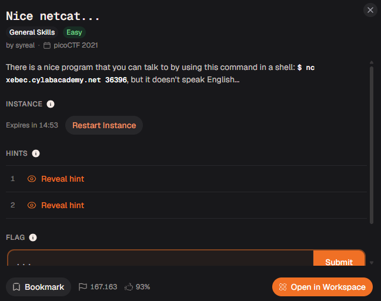
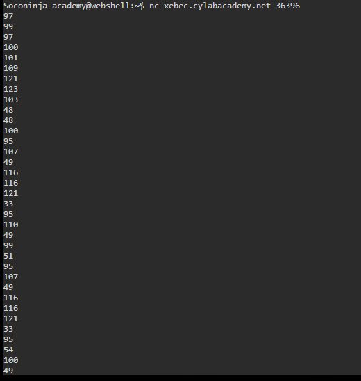
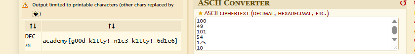

# Relatório – Desafio “Nice netcat...”

**Disciplina:** Escola de Cyber

**Aluno:** Murilo Soares Guislande

**Data:** 11/11/2026

---

## 1. Objetivo

O objetivo desta atividade foi conectar-se a um serviço remoto utilizando o **netcat**, analisar a resposta recebida (que não estava em formato legível) e identificar a codificação utilizada para ocultar a *flag*. A resolução exigiu o reconhecimento do formato dos dados e o uso da ferramenta **dCode** para converter a saída em texto.

---

## 2. Ambiente Utilizado

* **Terminal:** Webshell da plataforma Escola de Cyber
* **Navegador:** Google Chrome
* **Ferramenta de Decodificação:** dCode – ASCII Converter
* **Plataforma do Desafio:** Escola de Cyber (desafio originário do picoCTF 2021)

---

## 3. Descrição do Desafio

O desafio **“Nice netcat...”** (categoria *General Skills*, dificuldade *Easy*) apresentava a seguinte descrição:

> *“There is a nice program that you can talk to by using this command in a shell: `$ nc xebec.cylabacademy.net 36396`, but it doesn't speak English...”*

A frase final (*“mas ele não fala inglês”*) indicava que a resposta do programa não viria em texto comum. O modelo de resposta exigido era o formato de flag da plataforma (`academy{...}`).

### Tela do desafio



---

## 4. Análise Inicial

O enunciado fornecia diretamente o comando de conexão. O **netcat** (`nc`) é uma ferramenta que abre conexões TCP/UDP e permite enviar e receber dados de um serviço remoto, sendo comum em desafios de CTF.

A hipótese inicial foi:

* Ao se conectar, o serviço enviaria alguma resposta;
* Como o programa “não falava inglês”, a resposta estaria codificada de alguma forma, e não em texto legível.

---

## 5. Explicação Técnica do Processo

### 5.1 Conexão com o serviço

O comando fornecido foi executado no terminal:

```bash
nc xebec.cylabacademy.net 36396
```

Em vez de texto, o servidor respondeu com uma **lista de números, um por linha**:

```text
97
99
97
100
101
109
121
123
103
48
48
...
```

### 5.2 Identificação da codificação

Observando os valores, todos estavam entre **33 e 125**, faixa que corresponde aos caracteres imprimíveis da tabela **ASCII**. Isso indicou que cada número era o **código decimal de um caractere**.

Conferindo os primeiros valores manualmente:

| Decimal | Caractere |
| ------- | --------- |
| 97 | `a` |
| 99 | `c` |
| 97 | `a` |
| 100 | `d` |
| 101 | `e` |
| 109 | `m` |
| 121 | `y` |
| 123 | `{` |

Os primeiros números formam `academy{`, exatamente o prefixo esperado para a *flag*, o que confirmou a hipótese.

### 5.3 Decodificação com o dCode

Em vez de converter os números manualmente, a lista completa foi colada no **ASCII Converter** do dCode, que converte os códigos decimais em texto automaticamente.

---

## 6. Procedimento Realizado

1. O terminal da plataforma foi aberto.
2. O comando `nc xebec.cylabacademy.net 36396` foi executado.
3. A lista de números exibida pelo servidor foi copiada integralmente.
4. O site **dCode** (ASCII Converter) foi aberto no navegador.
5. Os números foram colados no campo *ASCII ciphertext (decimal, hexadecimal, etc.)*.
6. A ferramenta converteu os valores e exibiu a *flag* no resultado.
7. A *flag* foi copiada e enviada na plataforma.

---

## 7. Evidências da Execução

### Conexão com o servidor via netcat



### Decodificação dos números no dCode



---

## 8. Análise dos Resultados

O fluxo de resolução pode ser resumido na tabela abaixo:

| Etapa | Entrada | Operação | Saída |
| ----- | ------- | -------- | ----- |
| 1 | Comando `nc` | Conexão com o servidor | Lista de números decimais |
| 2 | Números decimais | ASCII Converter (dCode) | Texto legível / *Flag* |

Uma forma alternativa de obter o mesmo resultado, sem usar o dCode, seria converter os números diretamente no terminal:

```bash
nc xebec.cylabacademy.net 36396 | awk '{printf "%c", $1}'
```

Ou em Python:

```python
numeros = [97, 99, 97, 100, 101, 109, 121, 123]  # colar a lista completa
print("".join(chr(n) for n in numeros))
```

---

## 9. Resultado Obtido

A *flag* obtida e validada foi:

```text
academy{g00d_k1tty!_n1c3_k1tty!_6d1e6}
```

O texto em *leet speak* (`g00d_k1tty!_n1c3_k1tty!`) lê-se como **“good kitty! nice kitty!”**, uma brincadeira com o nome do desafio (*netcat*, “gato de rede”).

---

## 10. Conclusão

A atividade demonstrou na prática o uso do **netcat** para interagir com serviços remotos e reforçou que **codificação não é criptografia**: a conversão de caracteres em códigos ASCII decimais não protege informação alguma, pois qualquer pessoa que reconheça o padrão consegue reverter o texto em segundos.

O exercício também reforçou conceitos fundamentais de:

* conexão com serviços remotos via `nc`;
* tabela ASCII e representação de caracteres em decimal;
* reconhecimento de padrões em dados de saída, como o prefixo `academy{`;
* uso do **dCode** como ferramenta de apoio para conversões.

---

## 11. Referências

* netcat – Wikipedia: https://en.wikipedia.org/wiki/Netcat
* ASCII – Wikipedia: https://en.wikipedia.org/wiki/ASCII
* dCode – ASCII Converter: https://www.dcode.fr/ascii-code
* Documentação da Escola de Cyber
