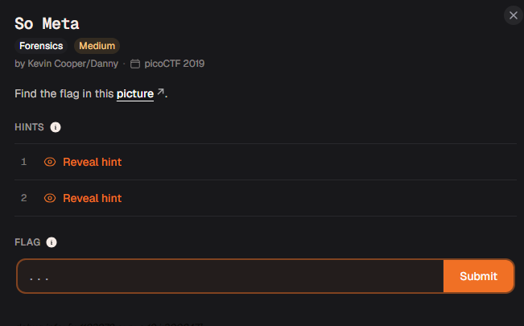
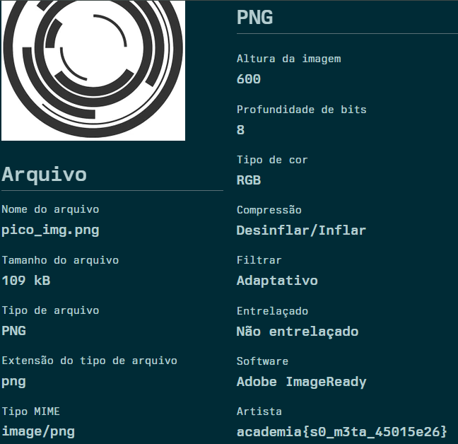

# Relatório – Desafio “So Meta”

**Disciplina:** Escola de Cyber

**Aluno:** Murilo Soares Guislande

**Data:** 11/11/2026

---

## 1. Objetivo

O objetivo desta atividade foi encontrar uma *flag* escondida em uma imagem fornecida pelo desafio. A resolução exigiu a análise dos **metadados** do arquivo com um visualizador de informações EXIF, identificando em qual campo a informação havia sido gravada.

---

## 2. Ambiente Utilizado

* **Navegador:** Google Chrome
* **Ferramenta de Análise:** visualizador de metadados EXIF online
* **Plataforma do Desafio:** Escola de Cyber (desafio originário do picoCTF 2019)

---

## 3. Descrição do Desafio

O desafio **“So Meta”** (categoria *Forensics*, dificuldade *Medium*) apresentava a seguinte descrição:

> *“Find the flag in this picture.”*

Junto ao enunciado era fornecida a imagem `pico_img.png`. O modelo de resposta exigido era o formato de flag da plataforma (`academy{...}`).

### Tela do desafio



---

## 4. Análise Inicial

A imagem exibe apenas um desenho de círculos concêntricos em tons de preto e branco, sem nenhum texto visível que indicasse uma *flag*.

O próprio nome do desafio (*So Meta*, em referência a **metadados**) já sugeria o caminho. A hipótese inicial foi:

* A *flag* não estaria na parte visual da imagem, mas gravada nos **metadados** do arquivo (dados embutidos que descrevem a imagem, como autor, software e datas).

---

## 5. Explicação Técnica do Processo

### 5.1 Análise dos metadados

A imagem foi enviada para um **visualizador de informações EXIF**, que listou os metadados do arquivo, organizados em categorias como *Arquivo* e *PNG*. Entre os campos observados:

| Campo | Valor |
| ----- | ----- |
| Nome do arquivo | `pico_img.png` |
| Tamanho do arquivo | 109 kB |
| Tipo de arquivo | PNG |
| Altura da imagem | 600 |
| Profundidade de bits | 8 |
| Tipo de cor | RGB |
| Compressão | Deflate/Inflate |
| Software | Adobe ImageReady |
| **Artista** | **`academy{...}`** |

A maior parte dos campos descrevia características técnicas comuns de um arquivo PNG. O campo **Artista** (*Artist*), porém, não continha um nome de pessoa, e sim um texto no formato de *flag*, escrito em texto claro, sem nenhuma codificação.

### 5.2 Obtenção da flag

Como a *flag* estava em texto claro no campo Artista, não foi necessária nenhuma decodificação adicional. Bastou copiar o valor exibido.

---

## 6. Procedimento Realizado

1. O arquivo `pico_img.png` foi baixado a partir do desafio.
2. A imagem foi enviada para um visualizador de metadados EXIF.
3. Os campos foram analisados até localizar o campo **Artista**, que continha a *flag*.
4. A *flag* foi copiada e enviada na plataforma.

---

## 7. Evidências da Execução

### Metadados da imagem com a flag no campo Artista



> Observação: a página do visualizador estava com tradução automática para o português (campos como “Artista” e “Altura da imagem”). Por isso, a palavra `academy` aparece traduzida como `academia` na captura. A *flag* original, no formato exigido pela plataforma, é `academy{...}`.

---

## 8. Análise dos Resultados

O fluxo de resolução pode ser resumido na tabela abaixo:

| Etapa | Entrada | Operação | Saída |
| ----- | ------- | -------- | ----- |
| 1 | `pico_img.png` | Leitura de metadados (EXIF) | Campos do arquivo |
| 2 | Campo **Artista** | Leitura direta (texto claro) | *Flag* |

Uma forma alternativa de obter o mesmo resultado seria usar o terminal:

```bash
exiftool pico_img.png
strings pico_img.png | grep -i "academy"
```

---

## 9. Resultado Obtido

A *flag* obtida e validada foi:

```text
academy{s0_m3ta_45015e26}
```

O texto em *leet speak* (`s0_m3ta`) lê-se como **“so meta”**, o próprio nome do desafio, confirmando que a informação estava mesmo nos metadados.

---

## 10. Conclusão

A atividade demonstrou que arquivos de imagem podem carregar informações importantes que não aparecem visualmente, como autor, software utilizado e até textos inseridos propositalmente. Diferentemente do desafio *information*, aqui a *flag* estava em **texto claro**, sem codificação, bastando saber onde procurar.

O exercício reforçou conceitos fundamentais de:

* análise forense básica de arquivos de imagem;
* leitura de metadados (EXIF e campos do formato PNG);
* importância de remover metadados antes de compartilhar arquivos, já que eles podem expor informações sensíveis como autoria, software e localização;
* uso de ferramentas de visualização de metadados.

---

## 11. Referências

* EXIF – Wikipedia: https://en.wikipedia.org/wiki/Exif
* ExifTool: https://exiftool.org/
* Documentação da Escola de Cyber
