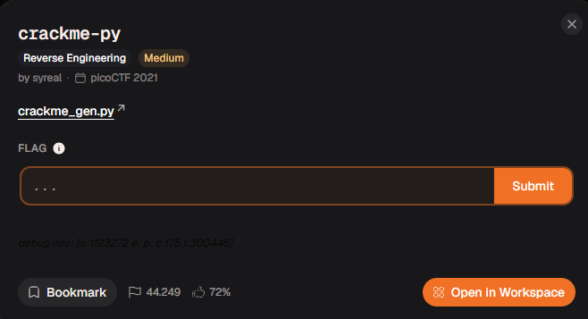
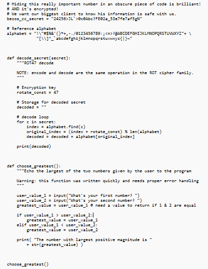
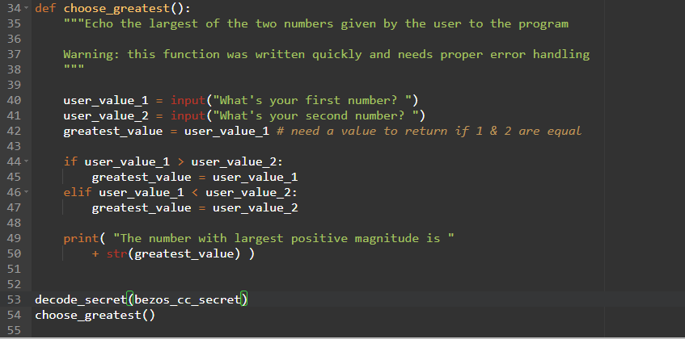
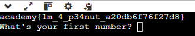

# Relatório – Desafio “Crackme”

**Disciplina:** Escola de Cyber

**Aluno:** Murilo Soares Guislande

**Data:** 11/11/2026

---

## 1. Objetivo

O objetivo desta atividade foi analisar um script em Python (`crackme_gen.py`) que armazenava um segredo cifrado e identificar como recuperar o texto original. A resolução exigiu leitura atenta do código-fonte, identificação do algoritmo de cifra descrito nos comentários e reaproveitamento de uma função já presente no próprio arquivo, que nunca era executada.

---

## 2. Ambiente Utilizado

* **Sistema Operacional:** Windows 11
* **Linguagem / Interpretador:** Python 3
* **Tipo de Análise:** Estática (leitura de código) seguida de execução
* **Plataforma do Desafio:** Escola de Cyber

---

## 3. Descrição do Desafio

O desafio consistia em um único arquivo, `crackme_gen.py`. Os comentários no topo do código davam a entender que um dado sensível estava “escondido” e “criptografado”:

> *“Hiding this really important number in an obscure piece of code is brilliant! AND it's encrypted!”*

O modelo de resposta esperado era o formato de flag da plataforma (`academy{...}`).

Ao abrir o arquivo, foram observados os seguintes elementos:

```python
bezos_cc_secret = "24256>JL`>0c0Abc?FE02a_53e7fe7af5gN"
```

### Tela do desafio



---

## 4. Análise Inicial

A leitura do código revelou três pontos importantes:

* A variável **`bezos_cc_secret`** guardava uma string sem sentido aparente, compatível com um texto cifrado;
* A variável **`alphabet`** continha os 94 caracteres ASCII imprimíveis (de `!` até `~`);
* A função **`decode_secret(secret)`** estava definida, mas **nunca era chamada**. No final do arquivo, a única chamada era `choose_greatest()`, que apenas pede dois números e mostra o maior, sem relação com o segredo.

A docstring da função indicava claramente o algoritmo utilizado:

```python
"""ROT47 decode

NOTE: encode and decode are the same operation in the ROT cipher family.
"""
```

A hipótese inicial foi:

* O segredo estava cifrado com **ROT47**;
* A função de decodificação já estava pronta no código, bastando chamá-la passando a variável com o segredo.

---

## 5. Explicação Técnica do Processo

### 5.1 Entendendo o ROT47

O ROT47 é uma cifra de substituição que desloca cada caractere em **47 posições** dentro de um alfabeto de **94 símbolos** (ASCII 33 a 126). Como 47 é exatamente a metade de 94, aplicar a operação duas vezes devolve o texto original. Por isso a mesma função serve para cifrar e decifrar, como a docstring avisa.

### 5.2 Entendendo a função `decode_secret`

```python
for c in secret:
    index = alphabet.find(c)
    original_index = (index + rotate_const) % len(alphabet)
    decoded = decoded + alphabet[original_index]
print(decoded)
```

Para cada caractere do segredo, a função:

1. Localiza a posição dele no alfabeto de referência;
2. Soma 47 a essa posição, usando módulo 94 para voltar ao início quando passa do fim;
3. Concatena o caractere da nova posição ao resultado e, no final, imprime o texto.

### 5.3 Chamando a função

Como a função já fazia exatamente o necessário, foi adicionada uma chamada ao script, passando a variável do segredo como parâmetro:

```python
decode_secret(bezos_cc_secret)
```

---

## 6. Procedimento Realizado

1. O arquivo `crackme_gen.py` foi aberto e lido por completo.
2. Foram identificados a variável com o segredo e a função `decode_secret`, não utilizada.
3. Pelos comentários e pela docstring, foi confirmado que se tratava de ROT47.
4. Foi adicionada ao código a chamada:
   * `decode_secret(bezos_cc_secret)`
5. O script foi executado no terminal com `python crackme_gen.py`.
6. O texto decodificado foi exibido no console, revelando a *flag*.

> Observação: se a chamada for colocada depois de `choose_greatest()`, o programa pede os dois números antes de decodificar. Para ver o resultado imediatamente, a chamada pode ser colocada antes dela.

---

## 7. Evidências da Execução

### Código original com o segredo e a função não utilizada



### Chamada adicionada ao script



### Execução e flag no console



---

## 8. Análise dos Resultados

O fluxo de resolução pode ser resumido na tabela abaixo:

| Etapa | Entrada | Operação | Saída |
| ----- | ------- | -------- | ----- |
| 1 | `bezos_cc_secret` (texto cifrado) | `decode_secret()` – ROT47 | Texto decodificado / *Flag* |

O ponto decisivo da resolução foi perceber que a função de decodificação já existia no código, sem ser usada, e que os comentários entregavam o algoritmo. Não foi necessário implementar nada novo.

Uma forma alternativa de obter o mesmo resultado, sem alterar o arquivo, seria usar o ROT47 diretamente em uma ferramenta como o **CyberChef** (operação `ROT47`) ou no terminal:

```bash
echo '24256>JL`>0c0Abc?FE02a_53e7fe7af5gN' | tr '!-~' 'P-~!-O'
```

---

## 9. Resultado Obtido

A *flag* obtida foi:

```text
academy{1m_4_p34nut_a20db6f76f27d8}
```

O texto em *leet speak* (`1m_4_p34nut`) lê-se como **“I'm a peanut”**, ironizando o comentário do código, que dizia que o segredo estava seguro.

---

## 10. Conclusão

A atividade demonstrou na prática que **ofuscação não é segurança**. O ROT47 é uma cifra sem chave secreta, e qualquer pessoa com acesso ao código (ou que reconheça o padrão) consegue reverter o texto em segundos.

O exercício também reforçou conceitos fundamentais de:

* análise estática de código-fonte;
* funcionamento da cifra ROT47 e de cifras simétricas simples;
* importância de verificar código não utilizado, que muitas vezes revela como os dados foram protegidos;
* boas práticas de segurança, como nunca armazenar segredos no código-fonte nem protegê-los com algoritmos reversíveis sem chave, preferindo gerenciadores de segredos e criptografia real (como AES com chave guardada fora do código).

---

## 11. Referências

* ROT13 / ROT47 – Wikipedia: https://en.wikipedia.org/wiki/ROT13
* Documentação da Escola de Cyber
