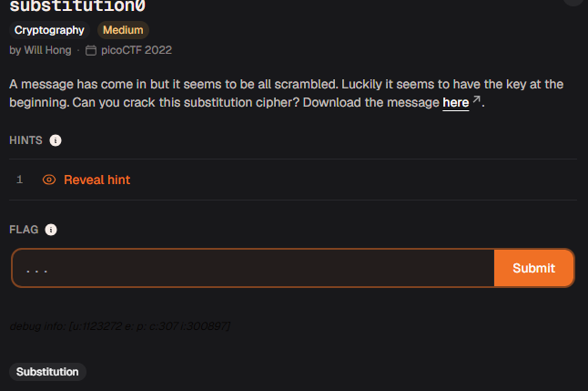
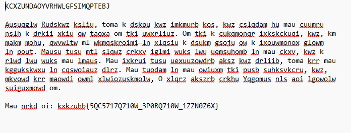
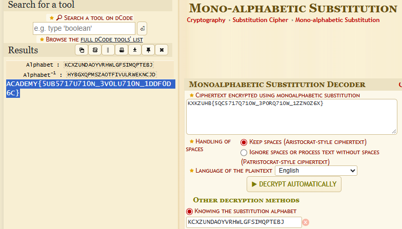

# Relatório – Desafio “substitution0”

**Disciplina:** Escola de Cyber

**Aluno:** Murilo Soares Guislande

**Data:** 11/11/2026

---

## 1. Objetivo

O objetivo desta atividade foi decifrar uma mensagem protegida por uma **cifra de substituição monoalfabética**, cuja chave estava presente no próprio arquivo fornecido. A resolução exigiu a leitura do arquivo, a identificação do tipo de cifra com o auxílio do **dCode** e a aplicação da chave correta no decodificador.

---

## 2. Ambiente Utilizado

* **Navegador:** Google Chrome
* **Ferramenta de Análise:** dCode (Cipher Identifier e Monoalphabetic Substitution Decoder)
* **Plataforma do Desafio:** Escola de Cyber (desafio originário do picoCTF 2022)

---

## 3. Descrição do Desafio

O desafio **“substitution0”** (categoria *Cryptography*, dificuldade *Medium*) apresentava a seguinte descrição:

> *“A message has come in but it seems to be all scrambled. Luckily it seems to have the key at the beginning. Can you crack this substitution cipher? Download the message here.”*

O enunciado informava que a mensagem estava embaralhada e que a **chave estava no início do arquivo**. O modelo de resposta exigido era o formato de flag da plataforma (`academy{...}`).

### Tela do desafio



---

## 4. Análise Inicial

Ao abrir o arquivo `message.txt`, foi observada a seguinte estrutura:

* **Primeira linha:** uma sequência de 26 letras maiúsculas, sem repetição, que correspondia à chave:

  ```text
  KCXZUNDAOYVRHWLGFSIMQPTEBJ
  ```

* **Corpo do arquivo:** um texto longo em inglês, embaralhado, com palavras e pontuação preservadas, mas com as letras trocadas.
* **Última linha:** um trecho no formato de flag, também embaralhado:

  ```text
  kxkzuhb{5QC5717Q710W_3P0RQ710W_1ZZN0Z6X}
  ```

A estrutura `xxxxxxx{...}` com 7 letras antes da chave indicava que o trecho era a *flag* cifrada, já que `academy` também tem 7 letras. A hipótese inicial foi:

* O texto foi cifrado com uma **substituição simples**, em que cada letra do alfabeto é trocada sempre por uma mesma outra letra;
* A sequência de 26 letras no início seria o **alfabeto de substituição** necessário para reverter a cifra.

### Arquivo fornecido pelo desafio



---

## 5. Explicação Técnica do Processo

### 5.1 Identificação do tipo de cifra

O trecho que parecia ser a *flag* cifrada foi colado no **dCode**, na ferramenta de identificação de cifras. A ferramenta sugeriu o uso de uma **cifra de substituição (monoalfabética)**, confirmando a hipótese.

### 5.2 Como a chave funciona

Em uma cifra de substituição monoalfabética, a chave é um alfabeto embaralhado. A posição de cada letra no alfabeto normal indica por qual letra ela é trocada:

| Alfabeto normal | A | B | C | D | E | F | ... |
| --------------- | - | - | - | - | - | - | --- |
| Alfabeto da chave | K | C | X | Z | U | N | ... |

Assim, no texto cifrado, a letra `K` representa `A`, a letra `C` representa `B`, e assim por diante. Isso explica a *flag* cifrada: `kxkzuhb` corresponde a `academy`.

Como existem 26! combinações possíveis de alfabeto, quebrar essa cifra sem a chave exigiria outros métodos, como análise de frequência. Neste desafio, porém, a chave foi entregue junto com a mensagem.

### 5.3 Decifração com o dCode

No **Monoalphabetic Substitution Decoder** do dCode, foi localizada a opção **“Knowing the substitution alphabet”** (conhecendo o alfabeto de substituição). Nela, foi colada a chave retirada da primeira linha do arquivo, e o texto cifrado foi inserido no campo principal.

---

## 6. Procedimento Realizado

1. O arquivo `message.txt` foi baixado e aberto.
2. A primeira linha (chave de 26 letras) foi identificada.
3. O trecho com formato de flag foi copiado e colado no **Cipher Identifier** do dCode, que apontou uma cifra de substituição.
4. O **Monoalphabetic Substitution Decoder** foi aberto.
5. Na opção **“Knowing the substitution alphabet”**, a chave `KCXZUNDAOYVRHWLGFSIMQPTEBJ` foi informada.
6. O texto cifrado foi colado no campo de entrada e a decifração foi executada.
7. A ferramenta exibiu a *flag* decifrada, que foi copiada e enviada na plataforma.

---

## 7. Evidências da Execução

### Decifração no dCode com a chave informada



---

## 8. Análise dos Resultados

O fluxo de resolução pode ser resumido na tabela abaixo:

| Etapa | Entrada | Operação | Saída |
| ----- | ------- | -------- | ----- |
| 1 | Trecho cifrado | Cipher Identifier (dCode) | Cifra de substituição identificada |
| 2 | Texto cifrado + chave da 1ª linha | Monoalphabetic Substitution Decoder | Texto decifrado / *Flag* |

O dCode exibe o resultado em letras maiúsculas. Como o texto cifrado original estava em minúsculas e o formato exigido pela plataforma é `academy{...}`, a *flag* foi escrita em minúsculas ao ser enviada.

Uma forma alternativa de obter o mesmo resultado, sem o dCode, seria um script em Python:

```python
import string

chave = "KCXZUNDAOYVRHWLGFSIMQPTEBJ"
tabela = {chave[i]: string.ascii_uppercase[i] for i in range(26)}

cifrado = "kxkzuhb{5QC5717Q710W_3P0RQ710W_1ZZN0Z6X}"
print("".join(
    tabela.get(c.upper(), c).lower() if c.isalpha() else c
    for c in cifrado
))
```

---

## 9. Resultado Obtido

A *flag* obtida e validada foi:

```text
academy{5ub5717u710n_3v0lu710n_1ddf0d6c}
```

O texto em *leet speak* (`5ub5717u710n_3v0lu710n`) lê-se como **“substitution evolution”** (“evolução da substituição”), uma referência ao tema do desafio.

---

## 10. Conclusão

A atividade demonstrou o funcionamento de uma **cifra de substituição monoalfabética** e mostrou que ela é fácil de reverter quando a chave está disponível. Mesmo sem a chave, esse tipo de cifra é considerado fraco, pois a **análise de frequência** das letras permite quebrá-la, já que a mesma letra sempre vira a mesma outra letra.

O exercício reforçou conceitos fundamentais de:

* cifras de substituição e o papel do alfabeto como chave;
* identificação de cifras com o auxílio de ferramentas como o **dCode**;
* análise da estrutura de um arquivo para encontrar pistas (chave no início e trecho no formato de flag);
* importância de nunca distribuir a chave junto com a mensagem cifrada.

---

## 11. Referências

* Substitution cipher – Wikipedia: https://en.wikipedia.org/wiki/Substitution_cipher
* dCode – Monoalphabetic Substitution: https://www.dcode.fr/monoalphabetic-substitution
* dCode – Cipher Identifier: https://www.dcode.fr/cipher-identifier
* Documentação da Escola de Cyber
