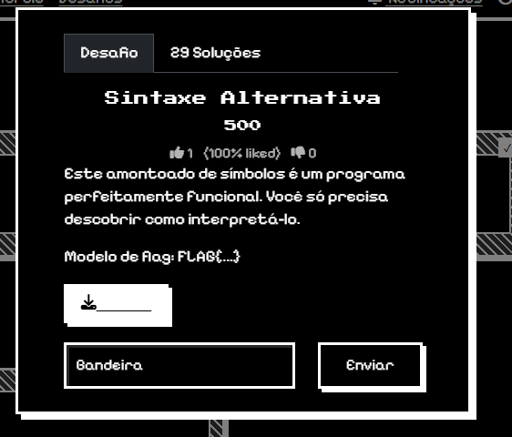

# EscolaDeCyber
# Relatório – Desafio “Sintaxe Alternativa”

**Disciplina:** Escola de Cyber  
**Aluno:** Murilo Soares Guislande  
**Data:** 11/08/2026

---

## 1. Objetivo

O objetivo desta atividade foi identificar e interpretar um código composto apenas por símbolos especiais, reconhecendo que ele correspondia à linguagem **Brainfuck**. Após a identificação, o código foi executado em uma ferramenta online para decodificar a mensagem e descobrir a *flag* do desafio.

---

## 2. Ambiente Utilizado

- **Sistema Operacional:** Windows 11
- **Navegador:** Google Chrome
- **Ferramenta online:** dCode – Brainfuck Interpreter
- **Plataforma do desafio:** Escola de Cyber

---

## 3. Descrição do Desafio

O desafio apresentava um texto formado por símbolos como `+`, `-`, `<`, `>`, `[ ]` e `.` e informava que aquele conjunto de caracteres era um programa funcional. O objetivo era descobrir como interpretá-lo para obter a *flag*.

### Tela do desafio

**[INSERIR IMAGEM 1 – Tela do desafio “Sintaxe Alternativa”]**

Exemplo:

```md

```

---

## 4. Identificação da Linguagem

O código foi copiado para a ferramenta **Cipher Identifier** do site dCode. A análise indicou que o padrão de símbolos era compatível com a linguagem **Brainfuck**, uma linguagem esotérica de programação que utiliza apenas oito comandos.

### Resultado da identificação

**[INSERIR IMAGEM 2 – dCode identificando Brainfuck]**

---

## 5. Procedimento Realizado

### Passo 1 – Copiar o código do desafio

O conteúdo do desafio foi copiado integralmente para análise.

### Passo 2 – Identificar a linguagem

O código foi colado no identificador do dCode, que sugeriu a linguagem Brainfuck.

### Passo 3 – Executar o código

O código foi inserido no **Brainfuck Interpreter** do dCode e executado.

### Passo 4 – Obter a saída

Após a execução, a ferramenta retornou a *flag* decodificada.

---

## 6. Evidências da Execução

A execução do programa no interpretador Brainfuck produziu a seguinte saída:

```text
FLAG{c0d1g0_3s0t3r1c0}
```

### Execução no interpretador

**[INSERIR IMAGEM 3 – Brainfuck Interpreter com a saída da flag]**

---

## 7. Análise Técnica

A linguagem Brainfuck manipula uma fita de memória por meio de comandos simples. O programa fornecido utilizava repetições (`[ ]`) para gerar valores ASCII e o comando `.` para imprimir caracteres. A sequência de instruções produziu gradualmente os caracteres que formam a *flag*.

Os principais comandos utilizados são:

| Comando | Função |
|---|---|
| `>` | Move o ponteiro para a direita |
| `<` | Move o ponteiro para a esquerda |
| `+` | Incrementa o valor da célula |
| `-` | Decrementa o valor da célula |
| `[` | Início de laço |
| `]` | Fim de laço |
| `.` | Imprime o caractere ASCII |
| `,` | Lê entrada do usuário |

O desafio exigiu principalmente a capacidade de **reconhecer padrões de linguagens esotéricas** e utilizar ferramentas adequadas para interpretação do código.

---

## 8. Resultado Obtido

A *flag* obtida foi:

```text
FLAG{c0d1g0_3s0t3r1c0}
```

O objetivo do desafio foi alcançado com sucesso.

---

## 9. Dificuldades Encontradas

Durante a atividade, a principal dificuldade foi identificar a linguagem correta apenas observando os símbolos do código. Essa etapa foi resolvida utilizando a ferramenta de identificação do dCode.

---

## 10. Conclusão

A atividade permitiu compreender como linguagens esotéricas podem ser utilizadas em desafios de segurança e CTFs. O uso do dCode facilitou a identificação e execução do programa Brainfuck, possibilitando a obtenção da *flag*. O exercício reforçou habilidades de análise de padrões, pesquisa técnica e interpretação de código não convencional.

---

## 11. Referências

- dCode – Brainfuck Interpreter: https://www.dcode.fr/brainfuck-language
- dCode – Cipher Identifier: https://www.dcode.fr/cipher-identifier
- Documentação da Escola de Cyber

---

## Estrutura sugerida no GitHub

```text
atividade-brainfuck/
│
├── README.md
└── imagens/
    ├── desafio.png
    ├── identificacao.png
    └── execucao.png
```

Após salvar as imagens na pasta `imagens`, substitua os marcadores `[INSERIR IMAGEM X]` pelos links em Markdown:

```md

```
